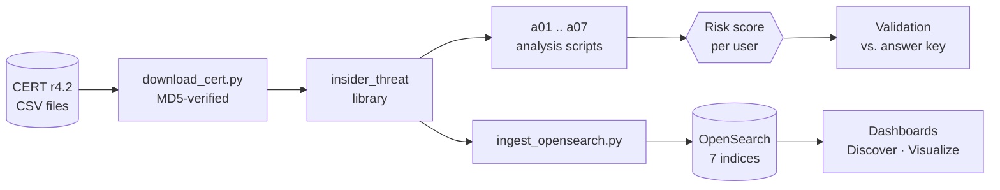

<div align="center">


<a href="#-quick-start">
  
</a>

<br />


<br />


<br /><br />

**[Quick start](#-quick-start)** ·
**[How it works](#-how-it-works)** ·
**[Dataset](#-dataset)** ·
**[OpenSearch](#-opensearch-and-dashboards)** ·
**[Analyses](#-analyses)** ·
**[Results](#-results)** ·
**[Support](#-support-the-project)**

</div>

---

## 🔎 About

A reproducible analysis of the **CERT Insider Threat Test Dataset (release r4.2)**.
Seven detection analyses go from suspicious web browsing to a correlated
per-user risk score, validated against the official insider answer key. A local
**OpenSearch + OpenSearch Dashboards** environment exposes the same data for
interactive investigation, with derived fields and ready-made risk indices.

<div align="center">

| 👥 Users | 🕵️ Insiders | 🌐 Web requests | 📧 E-mails | 🔌 USB connections | 🎯 precision@10 |
|:---:|:---:|:---:|:---:|:---:|:---:|
| **1,000** | **70** | **28.4 M** | **2.6 M** | **203 K** | **100 %** |

</div>

## 🧭 How it works



The library in `src/insider_threat/` holds every rule (work hours, sessions,
web categories, baselines, score), so the analysis scripts and the OpenSearch
indices compute exactly the same signals.

## 🚀 Quick start

> [!NOTE]
> The full dataset needs about **25 GB** of free disk (4.6 GB download, about
> 15.5 GB extracted) and Docker with at least **4 GB** of memory for OpenSearch.

```bash
git clone https://github.com/nilsonsangy/insider-threat-cert.git
cd insider-threat-cert
cp .env.example .env                               # Windows PowerShell: Copy-Item .env.example .env
uv sync                                            # creates .venv and installs the dependencies
uv run python scripts/download_cert.py --extract   # dataset into data/
uv run python scripts/a06_validation.py            # ranking validated against the answer key
docker compose up -d                               # OpenSearch on :9200, Dashboards on :5601
uv run python scripts/ingest_opensearch.py         # about 55 minutes, 8.4 GB of indices
```

<details>
<summary><b>📦 Installing uv</b></summary>

```powershell
powershell -ExecutionPolicy ByPass -c "irm https://astral.sh/uv/install.ps1 | iex"   # Windows PowerShell
```
```bash
curl -LsSf https://astral.sh/uv/install.sh | sh                                     # Linux and macOS
```

`uv sync` creates the `.venv` directory in the repository root. Every command
runs inside it through `uv run`, with no manual activation. Docker Compose and
the scripts read the same `.env` file.

</details>

## 📚 Dataset

The CERT Insider Threat Test Dataset (r4.2) was generated by the CERT Division
of the Software Engineering Institute (Carnegie Mellon University) in
partnership with ExactData, LLC. Background activity and the malicious actors
are synthetic, and three insider scenarios are injected.

| Source | Content | Size |
|---|---|---|
| `logon.csv` | Logon / Logoff events | 56 MB |
| `device.csv` | USB Connect / Disconnect (203,339 connections) | 28 MB |
| `file.csv` | File copies (445,581) | 184 MB |
| `email.csv` | E-mail metadata (2,629,979) | 1.3 GB |
| `http.csv` | Web requests (28,434,423, 475 distinct hosts) | 13.9 GB |
| `LDAP/` | 18 monthly snapshots, 1,000 users with role and department | small |
| `answers/insiders.csv` | Answer key: 70 r4.2 insiders in 3 scenarios (30 / 30 / 10) | small |

<table>
<tr>
<td width="33%" valign="top">

### 1️⃣ Leak
A user who did not work after hours starts logging on after hours, uses a
removable drive and uploads data to **wikileaks.org**, then leaves.

</td>
<td width="33%" valign="top">

### 2️⃣ Departure
A user browses **job sites**, solicits employment from a competitor and,
before leaving, copies data to a thumb drive at a markedly higher rate.

</td>
<td width="33%" valign="top">

### 3️⃣ Sabotage
A system administrator installs a **keylogger** on a supervisor's machine and
uses the captured credentials to send a **mass e-mail**.

</td>
</tr>
</table>

```bash
uv run python scripts/download_cert.py --dry-run    # source, terms of use and what is missing
uv run python scripts/download_cert.py --extract    # download (MD5-verified) and extract incrementally
```

The CSV files land in `data/r4.2/` and the answer key in `data/answers/`. The
`data/` folder is ignored by Git and created by the download script.

- **Source:** *Insider Threat Test Dataset*, Carnegie Mellon University, on
  KiltHub: <https://kilthub.cmu.edu/articles/dataset/Insider_Threat_Test_Dataset/12841247>
  (DOI 10.1184/R1/12841247).
- **Reference:** Glasser, J.; Lindauer, B. *Bridging the Gap: A Pragmatic
  Approach to Generating Insider Threat Data*. IEEE Security and Privacy
  Workshops, 2013.
- **Mirror:** <https://www.kaggle.com/datasets/andrihjonior/cert-insider-threat-dataset-r4-2>.
  The download script uses the KiltHub source and verifies MD5 checksums.

## 🗄️ OpenSearch and Dashboards

```bash
docker compose up -d
uv run python scripts/ingest_opensearch.py
```

| Option | Effect |
|---|---|
| `--only logon,http` | Ingests only the listed targets (`logon`, `device`, `file`, `email`, `http`, `copy-daily`, `risk`). |
| `--recreate` | Deletes the selected indices before creating them again. |
| `--resume` | Continues an interrupted load from the last confirmed batch. |
| `--start-row N` | Starts one source (`--only http`) at data row `N`. |

> [!TIP]
> **Interrupted load? Nothing is sent twice.** Every row is stored with its CSV
> `id` as `_id`, and a checkpoint with the byte offset of the last confirmed
> batch is written to `data/.ingest-<source>.json`. `--resume` jumps straight to
> the first row not yet stored, checks that the row before it is stored and the
> row at it is not, and sends the rest as `create`, which never overwrites a
> document.

The ingestion creates five event indices (`cert-logon`, `cert-device`,
`cert-file`, `cert-email`, `cert-http`) with derived fields (`off_hours`,
`role`, `recipients`, `domain`, `category`) and two derived indices:
`cert-copy-daily` (file copies per user and day) and `cert-risk` (one document
per user with the five signals and the score).

Then open <http://localhost:5601>, set `dateFormat:tz` to `UTC` in
**Dashboards Management → Advanced settings**, create the index pattern
`cert-*` with `date` as the time field, and query in **Discover** with DQL:

```text
user:CSC0217 and activity:Logon
activity:Connect and off_hours:true
category:leak_site
recipients >= 8
```

Query examples, the field reference and the visualizations are in
[docs/opensearch.md](./docs/opensearch.md).

## 🧪 Analyses

Each analysis is a script, run with `uv run python scripts/<name>.py`:

| # | Script | Insider signal | ATT&CK |
|:---:|---|---|:---:|
| 1 | `a01_web_browsing.py` | job sites, leak sites, cloud storage, spyware vendors | T1567 |
| 2 | `a02_usb_exfiltration.py` | file copies made while a USB device is connected | T1052 |
| 3 | `a03_off_hours_usb.py` | off-hours USB connection inside the user's own session | T1078 + T1052 |
| 4 | `a04_file_copy_baseline.py` | copy volume above 3x the peer-group (role) norm | T1052 |
| 5 | `a05_correlation.py` | signals combined into an additive score per user | T1052 / T1567 / T1078 |
| 6 | `a06_validation.py` | ranking and each signal checked against the answer key | n/a |
| 7 | `a07_mass_email.py` | e-mail with 8 or more recipients and USB use by another user on the same PC in the previous 48 hours | T1078 |

```bash
uv run python scripts/a01_web_browsing.py        # about 2-3 min the first time, then cached
uv run python scripts/a03_off_hours_usb.py --work-hours 8-18
uv run python scripts/a04_file_copy_baseline.py --factor 2.5
uv run python scripts/a07_mass_email.py --min-recipients 8 --window-hours 48
```

<details>
<summary><b>⚖️ Risk score weights</b></summary>

Weights (`src/insider_threat/score.py`) are fixed a priori by how specific each
behavior is. They are not fitted to the answer key, which is used only in
analysis 6.

| Signal | Weight |
|---|:---:|
| Logon outside work hours (07h-19h) | +1 |
| Off-hours USB connection inside the user's own logon session | +2 |
| Mean copies/day above 3x the role baseline | +3 |
| Job site or cloud storage browsing (common, weak) | +1 |
| Leak site or spyware browsing (rare, specific) | +3 |

</details>

<details>
<summary><b>🌐 Suspicious domain lists</b></summary>

The lists in `src/insider_threat/domains.py` contain only hosts that occur in
the r4.2 HTTP log, grouped by what the site is:

- `job_site`: careerbuilder, monster, simplyhired, indeed, job-hunt.org,
  jobhuntersbible, taleo
- `leak_site`: wikileaks.org
- `cloud_storage`: dropbox, yousendit, mediafire, megaupload, filesonic,
  fileserve, 4shared
- `spyware`: keylogger and covert-monitoring vendors (dailykeylogger, refog,
  spectorsoft, and others)

</details>

<details>
<summary><b>⏱️ Run times and cache</b></summary>

- Analysis 1 streams all 28M HTTP rows (about 2-3 minutes) and caches the
  per-user counts in `data/derived/web_hits.csv`. Analyses 5, 6 and 7 and the
  `cert-risk` index reuse that cache. It is rebuilt when `http.csv` changes, or
  on demand with `--refresh`.
- Analyses 2 to 4 take about 30 seconds each.
- Analysis 7 finds 4 messages and 5 USB candidates with the defaults. Four
  candidates are scenario 3 insiders who also visited keylogger vendors. The
  criterion covers 4 of the 10 scenario 3 insiders.

</details>

## 📊 Results

Output of `uv run python scripts/a06_validation.py` over the complete r4.2 data:

<div align="center">

| 🎯 precision@10 | 🎯 precision@30 | 🎯 precision@70 | 1️⃣ Scenario 1 | 2️⃣ Scenario 2 | 3️⃣ Scenario 3 |
|:---:|:---:|:---:|:---:|:---:|:---:|
| **100.0 %** | **76.7 %** | **57.1 %** | **30 / 30** | **0 / 30** | **10 / 10** |

<sub>Scenario columns: insiders of each scenario in the top 70 of the ranking.</sub>

</div>

| Signal | Users flagged | Insiders among them | Precision | Recall |
|---|---:|---:|---:|---:|
| Off-hours logon | 190 | 42 | 22.1% | 60.0% |
| Off-hours USB in own session | 104 | 42 | 40.4% | 60.0% |
| Copies above 3x role baseline | 47 | 13 | 27.7% | 18.6% |
| Job site / cloud storage browsing | 983 | 69 | 7.0% | 98.6% |
| Leak site / spyware browsing | 40 | 40 | 100.0% | 57.1% |

> [!IMPORTANT]
> - **Rare, specific behaviors carry the signal.** All 40 users who visited
>   wikileaks.org or a keylogger vendor are insiders (scenarios 1 and 3).
> - **Common behaviors are noise on their own.** Job sites and cloud storage are
>   visited by 983 of the 1,000 users.
> - **USB is the exfiltration channel.** 441,885 of the 445,581 file copies
>   (99.2%) happen while a USB device is connected.
> - **Scenario 2 is not caught (0/30).** Those insiders behave like their peers
>   in absolute terms; detecting them needs a change-over-time baseline (each
>   user against their own history).

## ✅ Tests

```bash
uv run pytest -q
```

The tests read the CERT r4.2 files under `data/` and fail with the download
command when they are missing. They pin facts of the r4.2 release (row counts,
1,000 users, 70 insiders), check the analyses end to end and include
property-based tests of the configuration, the recipient count and the derived
fields. They do not require Docker.

```bash
docker compose down -v    # stop OpenSearch and remove the volume with the indices
```

## 🗂️ Repository layout

<details>
<summary><b>Show the tree</b></summary>

```text
insider-threat-cert/
├── README.md                 # this guide
├── LICENSE                   # MIT (project code)
├── .env.example              # environment template (copy to .env)
├── pyproject.toml / uv.lock  # dependencies, managed by uv
├── docker-compose.yml        # OpenSearch and OpenSearch Dashboards
├── docs/opensearch.md        # ingestion and Dashboards guide
├── src/insider_threat/       # library, no executables
│   ├── loaders.py            # reading the CSV sources and the answer key
│   ├── timewin.py            # work hours and logon sessions
│   ├── domains.py            # web category of each host
│   ├── web.py                # visits per user and category (cached scan of http.csv)
│   ├── baseline.py           # copies per day and per-role baseline
│   ├── score.py              # signals, weights and risk score
│   ├── mass_email.py         # recipient count and mass-email criterion
│   ├── enrich.py             # derived fields added before indexing
│   ├── env.py                # .env loader
│   └── opensearch/           # mappings, _bulk, resume, derived indices, ingestion
├── scripts/                  # everything that is run: uv run python scripts/<name>.py
│   ├── download_cert.py      # download and extract the dataset
│   ├── ingest_opensearch.py  # load OpenSearch
│   └── a01_*.py .. a07_*.py  # the seven analyses
└── tests/                    # tests over the r4.2 files
```

The `data/` folder (dataset, derived cache and ingestion checkpoints) is
created by the scripts and ignored by Git.

</details>

## ☕ Support the project

<div align="center">

| 💳 PayPal | 🇧🇷 Pix (Brazil) |
|:---:|:---:|
| Support for the project is welcome through PayPal:<br>[**Donate with PayPal**](https://www.paypal.com/donate/?business=7CC3CMJVYYHAC&no_recurring=0&currency_code=BRL)<br><br> | Donors in Brazil can use Pix:<br>Pix key: `df92ab3c-11e2-4437-a66b-39308f794173`<br><br> |

</div>

## 📜 Data license and credits

The dataset is not versioned in this repository. It is downloaded from the
official source, which respects the dataset's terms of use. It was generated
by ExactData, LLC (© 2011, all rights reserved) under agreement with CMU/SEI,
is synthetic by design (no real employees), and has insider scenarios injected
by CERT. The license included in the dataset (`r4.2/license.txt`) applies to
the data.

The code is by Nilson Sangy and is under the [MIT license](./LICENSE), which
covers the code, not the dataset.

> [!WARNING]
> This project is for educational and research purposes. Monitoring real
> employees requires a legal basis, proportionality and the involvement of HR,
> Legal and Privacy.

<div align="center">


</div>